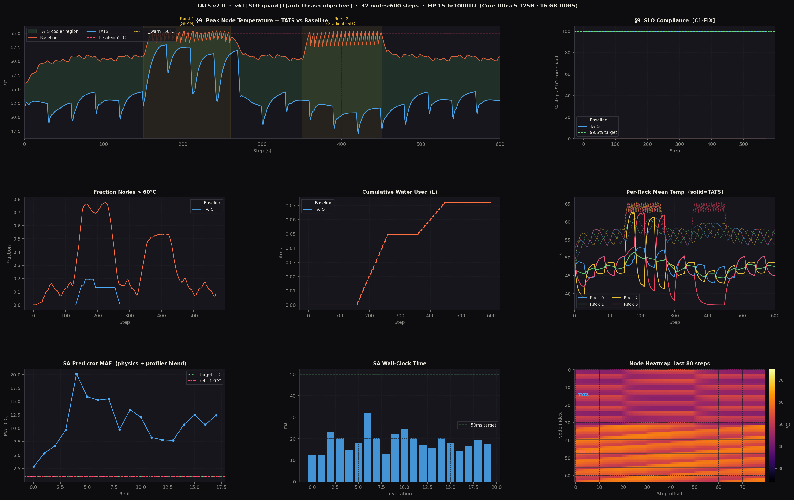
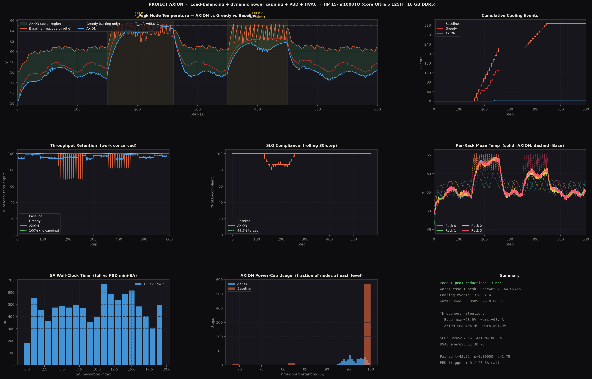
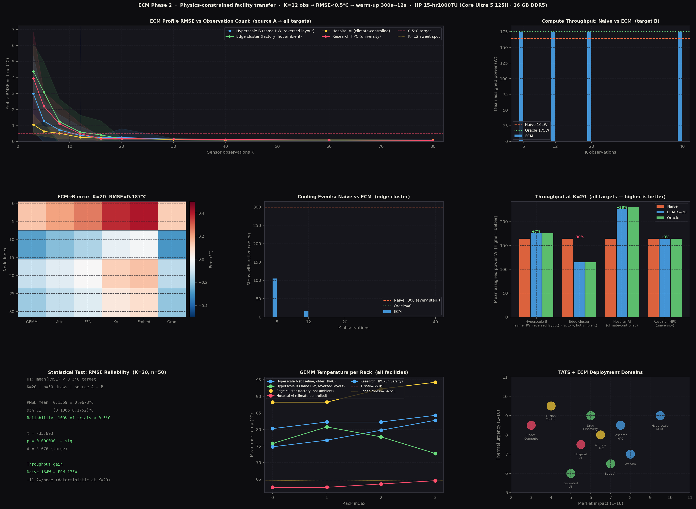

# Project AXION


Project AXION is a research repository for software-only thermal optimization in AI data centers. It contains simulation scripts for Thermally-Aware Tensor Scheduling (TATS), Evolutionary Constraint Mapping (ECM), and the AXION controller with predictive burst detection and SLO-aware power capping.

The goal is simple: reduce AI data-center hotspots before they become emergency cooling events, while preserving workload correctness and service-level objectives (SLOs). Instead of relying only on reactive hardware throttling or facility cooling, AXION treats thermal management as a predictive scheduling and control problem.

## Abstract

The rapid proliferation of large language models and dense tensor workloads has drastically increased power densities in AI data centers, resulting in localized hotspots, cooling inefficiencies, and thermal throttling. Traditional reactive cooling mechanisms incur high operational costs and induce latency violations.

Project AXION introduces a proactive thermal management framework that combines Thermally-Aware Tensor Scheduling (TATS), Predictive Burst Detection (PBD), dynamic SLO-aware power capping, and Evolutionary Constraint Mapping (ECM). By modeling the spatial-temporal thermal manifold with Tucker Decomposition and using Simulated Annealing for placement and cap selection, AXION reduces peak temperatures, sharply lowers emergency cooling events, and maintains strict SLO compliance in simulation.

## Core Idea

Modern AI workloads such as GEMM, attention, feed-forward networks, KV-cache operations, embeddings, and gradient updates produce uneven thermal stress. A conventional scheduler often reacts after a device has already crossed a thermal threshold. AXION acts earlier:

1. It predicts how each workload will affect each node.
2. It routes high-power work to cooler nodes without dropping work.
3. It applies only power caps that preserve latency constraints.
4. It detects fast burst onset through temperature slope monitoring.
5. It transfers thermal knowledge to new facilities using sparse sensor observations.

The result is a software-defined thermal controller that can reduce cooling pressure without requiring a new facility design.

## System Architecture

### Thermal Physics Model

AXION uses a physical simulation based on Newton's Law of Cooling and Runge-Kutta 4 (RK4) integration:

```text
C_i dT_i/dt = P_i - (T_i - T_in) / R_amb - sum_j((T_i - T_j) / R_ij)
```

The model includes:

- **Thermal coupling**: Heat from one server bleeds into nearby servers inside a rack and, more weakly, across racks.
- **ASHRAE rack-inlet bypass**: Hot exhaust from heavily loaded racks can recirculate and raise inlet temperature.
- **Emergency cooling dynamics**: Nodes above the safety threshold trigger last-resort evaporative cooling, modeled as water and energy cost.
- **Shared workload profile**: Six AI workload classes with different power and latency characteristics.

The shared constants and physics live in [Scripts/core.py](Scripts/core.py).

### Thermally-Aware Tensor Scheduling (TATS)

TATS is the predictive scheduling layer. It models data-center thermal history as a four-dimensional tensor:

```text
T in R^(nodes x sensors x time x workloads)
```

This tensor records how nodes behave across sensors, history windows, and workload types. To keep the representation tractable, TATS compresses the tensor with Tucker Decomposition. The compressed core and factor matrices are then projected forward to estimate what temperature a node will reach if a particular workload is assigned there.

TATS combines three prediction sources:

- **Physics projection**: A one-step thermal estimate from power deltas and effective resistance.
- **Welford profiler**: Online historical mean for each node-workload pair.
- **Tucker manifold**: A compressed thermal representation that gains trust as more refits complete.

The TATS simulation is implemented in [Scripts/tats_simulation.py](Scripts/tats_simulation.py).

### AXION Controller

The AXION controller is the decision layer. It makes scheduling and power decisions under a strict invariant: work is conserved. Heavy jobs are moved to better nodes; they are not silently removed.

AXION has three main mechanisms:

- **Greedy load balancing**: High-power jobs are assigned to cooler nodes using an `O(N log N)` ordering.
- **Dynamic power capping**: Per-node caps are selected from `{1.00, 0.85, 0.70, 0.55, 0.40}`.
- **Rack HVAC tuning**: Per-rack HVAC boost levels are included in the optimization objective.

For SLO-sensitive workloads, caps are only allowed when effective latency remains within the hard limit:

```text
L_eff = L_rated / cap <= L_MAX
```

The controller is implemented in [Scripts/axion.py](Scripts/axion.py).

### Predictive Burst Detection (PBD)

Standard scheduling periods can be too slow for sudden AI bursts. A high-power transition can drive a node upward by several degrees per second, so waiting for the next full scheduling interval can be too late.

PBD continuously monitors:

```text
dT/dt = (T_now - T_previous) / dt
```

It triggers a fast-path mini Simulated Annealing pass when the slope exceeds both:

- A physical floor threshold.
- A rolling statistical threshold based on recent slope mean and variance.

This catches true thermal transients while avoiding repeated false positives during normal cycling.

### Simulated Annealing Optimizer

Simulated Annealing evaluates candidate placements, caps, and HVAC levels with an objective that balances:

- Peak temperature reduction.
- Thermal-gradient smoothing.
- Penalty for temperatures above the safe threshold.
- Throughput retention.
- HVAC fan cost.

In the TATS scheduler, infeasible SLO decisions are rejected as hard constraints. In AXION, allowed cap sets are computed from latency limits before optimization.

### Evolutionary Constraint Mapper (ECM)

ECM addresses the cold-start problem. A new facility does not yet have enough thermal history for a mature tensor predictor, so ECM maps a known source facility to a new target facility using sparse sensor observations.

ECM fits a physics-constrained least-squares model over:

- Ambient resistance.
- Rack-level temperature offsets.
- Workload power response.

This gives the new facility a usable thermal profile after a small number of observations, rather than requiring a long warm-up period.

The ECM simulation is implemented in [Scripts/ecm_simulation.py](Scripts/ecm_simulation.py).

## Simulation Setup

The repository models a 32-node AI cluster across 4 racks. Each rack has 8 nodes. The simulation uses 600 time steps and six workload classes:

| Workload | Role | Power Profile |
| --- | --- | --- |
| GEMM | Dense matrix multiplication | High |
| Attention | Transformer attention | High |
| FFN | Feed-forward network | Medium |
| KV | KV-cache operation | Low |
| Embed | Embedding lookup | Very low |
| Grad | Gradient update / batch training | High |

The simulations compare proactive scheduling against reactive baselines that rely on throttling and emergency cooling after hotspots occur.

## Results

### TATS Results



The TATS simulation showed:

- Mean peak temperature reduction of about `8.06°C`.
- Emergency cooling events reduced from `465` to `0`.
- Total modeled water use reduced to `0`.
- TATS maintained `100%` SLO compliance in the simulation.
- Welch t-test result was statistically significant with a large effect size.

### AXION Controller Results



The AXION controller simulation showed:

- Mean peak temperature reduced from `61.64°C` baseline to `57.99°C`.
- Cooling events reduced from `328` baseline events to `4`.
- Total water use reduced by about `98.8%`.
- Cooling energy reduced by about `98.8%`.
- AXION maintained `100%` SLO compliance.
- Mean throughput retention remained about `96.4%`.

### ECM Transfer Results



The ECM simulation showed:

- Hyperscale B profile RMSE reduced from `5.50°C` naive transfer to about `0.163°C` with `K=20`.
- Edge cluster cooling events reduced from `300` to `0` at `K=20`.
- Hospital AI throughput improved by about `38%` versus naive transfer.
- Research HPC converged to near-oracle behavior with sparse observations.

## Research Summary

Project AXION demonstrates that data-center thermal management can be treated as a tensor-compressed spatial routing problem rather than a purely reactive cooling problem. Its main research contributions are:

- A thermal state tensor that captures node, sensor, time, and workload interactions.
- A Tucker-compressed predictor that makes workload placement thermally aware.
- A work-conserving scheduler that reroutes jobs instead of dropping them.
- SLO-aware power caps derived from workload latency constraints.
- Predictive Burst Detection for sudden thermal transients.
- ECM transfer learning for fast deployment in new facilities.

The broader implication is that software schedulers can reduce physical cooling demand and water use by avoiding thermal saturation before it occurs.

## Repository Map

- [Home.md](Home.md): Project landing page and main index.
- [Notes/Project_AXION_Research_Paper.md](Notes/Project_AXION_Research_Paper.md): Draft research paper.
- [Notes/Project_AXION_Explanation.md](Notes/Project_AXION_Explanation.md): Technical explanation of the system.
- [Scripts/core.py](Scripts/core.py): Shared simulation constants and thermal physics.
- [Scripts/tats_simulation.py](Scripts/tats_simulation.py): TATS simulation and result plot generation.
- [Scripts/ecm_simulation.py](Scripts/ecm_simulation.py): ECM transfer simulation and result plot generation.
- [Scripts/axion.py](Scripts/axion.py): AXION controller simulation and result plot generation.
- [Assets/icon.png](Assets/icon.png): Primary project icon.

## Run

Install the Python dependencies, then run scripts from the repository root:

```bash
pip install -r requirements.txt
python Scripts/axion.py
python Scripts/tats_simulation.py
python Scripts/ecm_simulation.py
```

Generated result plots are written to `Assets/`.

## Dependencies

The project uses:

- `numpy`
- `scipy`
- `matplotlib`
- `tensorly`

Install them with:

```bash
pip install -r requirements.txt
```

## Conclusion

Project AXION bridges tensor mathematics, thermal physics, and systems scheduling. By combining Tucker Decomposition, Simulated Annealing, SLO-aware power capping, and predictive burst detection, it shows a practical path toward lower water use, lower emergency cooling demand, and more stable AI data-center operation without discarding workloads or violating latency constraints.
